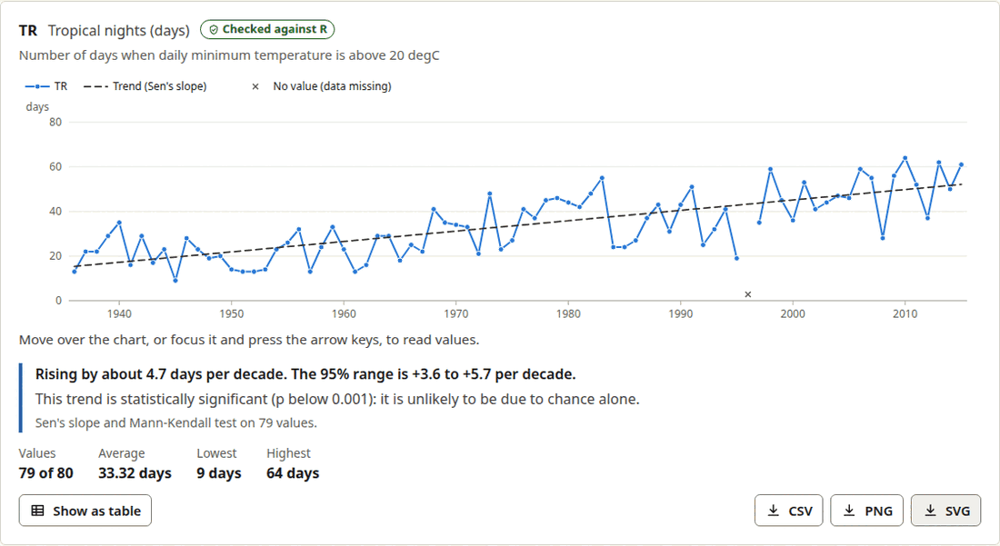
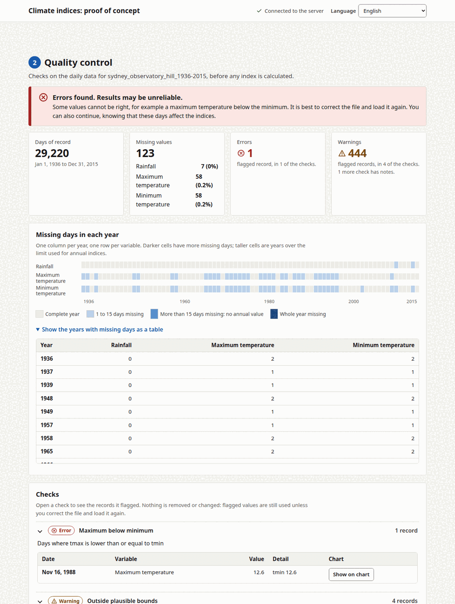
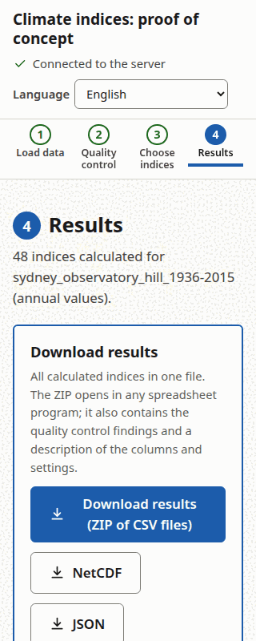

# climpoc: climate indices for station data, in Python on xclim

A proof of concept that explores a modern replacement for the Climpact workflow described in
WMO's public call for a Climpact modernisation: read a daily station file, check its quality,
compute climate indices, chart and export them, from a browser or the command line.

**Independent proof of concept. Not affiliated with or endorsed by WMO or the Climpact maintainers.**

**Live demonstration: <https://nolski.github.io/climate-indices-poc/>**

Checked against the original R tool, Climpact 3.4.4, value by value ([VALIDATION.md](VALIDATION.md)):

> **Default case: 81 index outputs compared (of 112 in the reference): 80 exact, 0 within tolerance, 1 differing; 31 not yet implemented. 7 variant cases together: 567 index outputs compared (of 784 in the reference): 562 exact, 0 within tolerance, 5 differing; 217 not yet implemented.**

Every difference is the same one, a missing-data rule of the southern-hemisphere growing season,
and it is explained there. What a Climpact user could not yet do here is listed, capability by
capability, in [docs/feature-parity.md](docs/feature-parity.md): **29 of 68 Climpact capabilities are present, 11 partial, 24 absent, and 4 are met differently by design.**



## Quick start

### With a container (Docker or podman)

```bash
podman build --format docker -t climpoc:0.1.0 .     # or: docker build -t climpoc:0.1.0 .
podman run --rm -p 127.0.0.1:8000:8000 --read-only --tmpfs /tmp climpoc:0.1.0
# or: docker compose up --build      /      podman compose up --build
```

Open <http://localhost:8000>, choose the sample station or upload a file. The first build
downloads the Python packages (about 190 MiB for the twelve largest alone) and the sample file;
it needs the network once, and the running container needs none. `--format docker` makes podman
keep the health check.

### Without a container

```bash
uv sync                          # creates .venv from the lock file (Python 3.12)
scripts/fetch_sample.sh          # optional: sample station file for the demo, tests and validation
uv run climpoc serve             # http://127.0.0.1:8000
```

### Command line (offline batch use)

```bash
uv run climpoc run my_station.txt --base 1991 2020 --lat -17.8 --lon 177.4 --out results/
uv run climpoc run my_station.txt --out results/ --indices txx tx90p cdd --frequency annual
uv run climpoc run my_station.txt --out results/ --rx-days 7 --hdd-base 15   # user-defined indices
uv run climpoc indices           # list the indices
```

`results/` then holds one Climpact-style CSV per index and frequency, a tidy CSV, a NetCDF file,
a trend table, the QC findings and a `README.txt` recording every setting and version.

Input format: plain text, one row per day, six columns `year month day precipitation(mm)
tmax(degC) tmin(degC)`, missing values `-99.9`; spaces, tabs, commas or semicolons; decimal
commas are accepted when the separator is not a comma; one header line is tolerated.

## Screenshots

| Quality control | Results on a phone |
|---|---|
|  |  |

## Scope: the work areas of WMO's call, and what exists here

| Work area | What this repository contains | Not done |
|---|---|---|
| Review of the existing software, architecture design | [baseline/README.md](baseline/README.md) records how the R tool behaves when run; [VALIDATION.md](VALIDATION.md) lists ten upstream behaviours to raise with the scientific lead; [docs/feature-parity.md](docs/feature-parity.md) compares capabilities; [docs/architecture.md](docs/architecture.md) is the design. | A full code review document. |
| Core framework for station and gridded data, modular for quality control, indices and homogeneity | `src/climpoc/`: parser, QC registry, declarative index registry, pluggable missing-data policies, trend statistics, exports; the web API and the command line are two thin shells over it. Adding an index is one registry entry, adding a QC check is one module (worked examples in the architecture document). | Gridded NetCDF input (designed for, not built). Homogeneity assessment. |
| Initial scientific functions: quality control and a selection of indices from xclim | 10 QC checks with adjustable thresholds; wherever the R tool reports the same check, the same dates are flagged on the sample. 48 indices: 32 are single xclim indicator calls; the rest add climdex-compatible percentile thresholds and bootstrap, year-crossing spells, the growing season from its definition and R95p as an amount. | Heatwave and EHF indices, SPI and SPEI, TXdTNd. |
| User interface: upload, select, compute, interactive charts, export | `web/` (static, no build step; see [web/README.md](web/README.md)) on the API described in [docs/api-contract.md](docs/api-contract.md): upload with line-numbered error messages, QC re-runs, index selection, charts, zip / NetCDF / JSON export. English and a draft French interface. | The user-defined index parameters in the interface; other languages. |
| Deployment online, low bandwidth, offline option | `Dockerfile` (multi-stage, non-root, read-only file system, health check), `compose.yaml`; compressed responses, cached assets, no external request at run time; opt-in cross-origin access and limits for a small public server. Measurements below. | A production service. An installer for Windows without containers. |
| Testing, documentation, handover | 195 tests (`uv run pytest`) with a GitHub Actions workflow that runs them; the validation harness `validate/compare.py` with a default case and seven variant cases run through the original R tool; this README and the documents under `docs/`. | An end-user guide. |

## What it does

* **Reads station files strictly and explains problems.** Every problem is reported with its
  line number and how to fix it ("Line 412: 1961-02-30 is not a valid calendar date"; "Line 9:
  tmin is 'NA', which is not a number. Write missing values as -99.9"), up to 50 at once,
  instead of a crash or a dropped connection. Repeated dates, rows out of order and absent days
  are errors by default; `--repair-dates` on the command line repairs them and says what it did.
* **Quality control** (`src/climpoc/qc/`): TX not above TN, negative precipitation, values
  outside plausible bounds, repeated dates, outliers by the boxplot rule per calendar month,
  outliers beyond N standard deviations of the day-of-year climatology, day-to-day jumps, runs
  of identical values, rounding patterns, missing days per month and year. Thresholds are
  parameters; QC can be re-run with other thresholds without uploading again.
* **Indices** (`src/climpoc/indices/`): FD, SU, ID, TR, TXx, TXn, TNx, TNn, DTR, TXm, TNm, TMm,
  Rx1day, Rx5day, RXdday, SDII, R10mm, R20mm, Rnnmm, PRCPTOT, CDD, CWD, TX90p, TN90p, TX10p,
  TN10p, TXgt50p, R95p, R99p, R95pTOT, R99pTOT, WSDI, CSDI, WSDId, CSDId, GSL, the fixed
  threshold counts (TXge30, TXge35, TNlt2, TNltm2, TNltm20, TMge5, TMlt5, TMge10, TMlt10) and
  degree days (HDDheatn, CDDcoldn, GDDgrown). Annual for all, monthly where the R tool
  produces monthly values. The user parameters of the R tool (spell lengths, degree-day bases,
  the RXdday window, the Rnnmm threshold) are settings of the API and the command line.
* **Missing data** as a named policy. The default reproduces Climpact: a month with more than 3
  missing days is missing; a year with more than 15, or with any missing month, is missing. The
  limits are settings, and two other policies (`any`, `fraction`) show that the rule is pluggable.
* **Trends**: Sen's slope with 95 % bounds and a Mann-Kendall p-value for every index; slope and
  bounds match the R tool's trend file on all 81 comparable rows.
* **Exports**: Climpact-style CSV per index (same layout as the R tool, so existing scripts keep
  working), tidy long-format CSV, NetCDF with CF attributes, and a zip of everything with a
  README that records settings and versions.

## Your data

Uploaded station data is held in the server's memory only, is deleted after 60 minutes (or the
time the server is configured for) or as soon as you ask, and is never written to disk: the
container runs with a read-only file system. The dataset identifier is a random 64-bit token.
There are no accounts; the server log records request paths, never file contents.

## Measurements

Measured on the development machine (8 cores, Linux, podman 5.7.1, rootless) in November 2026
with the 80-year sample station. They are one machine's numbers, not a benchmark.

| What | Result |
|---|---|
| Image size | 945 MB |
| Start: `podman run` until `/api/health` answers | 4.0 to 4.7 s in eight consecutive starts. Earlier starts took 5.4 s and 6.9 s, and two took 29 s and 34 s while the machine was busy with other work; the cause of those two was not established. |
| Memory | 270 MB 30 s after start; 357 MB after all annual and monthly indices for one dataset and all annual for a second; 399 MB after four more simultaneous full requests |
| All 48 annual indices, first request (in the container) | 3.6 s when requested 30 s after start, after the background warm-up; 6.8 s when requested earlier, during it |
| All 33 monthly indices (in the container) | 4.6 s |
| Same request again | served from memory, 0.03 s |
| Four users requesting all annual indices at the same moment | all answered; 3.2, 6.1, 9.1 and 11.6 s (requests are queued) |
| All annual / all monthly indices, warm process, outside the container | 2.0 to 4.6 s annual and 3.7 to 8.7 s monthly in five recorded runs of the validation script (the slowest while a container build was running; the fastest after the growing season stopped using xclim) |
| Reading and checking a station file | 80 years (0.7 MB): about 45 MB of working memory, 1 s including start-up; 500 years (4.3 MB): about 75 MB |
| xclim's own percentile bootstrap, for comparison | about 5 s per index (see VALIDATION.md) |

The start, memory and in-container timings were measured on the image built before the
user-parameter, growing-season and deployment-settings changes; the image was rebuilt and
checked after them (945 MB, healthy 3.9 s after start, all 48 annual indices in 5.9 s on a first request made during the warm-up, no errors), not re-measured in full.

The image is large because xclim's required dependencies are large (llvmlite and numba, pyarrow,
scipy, pandas, scikit-learn). The application code and front end are a small fraction of it.

## Running it for other people

The defaults suit one person on their own machine. A server that others can reach should set
limits by environment variable (all are validated at start-up; a bad value stops the server
with a message naming the variable; `GET /api/limits` reports them):

| Variable | Default | For a public demonstration on a 2 GB server |
|---|---|---|
| `CLIMPOC_MAX_UPLOAD_MB` | 20 | `2` |
| `CLIMPOC_MAX_DATASETS` | 50 | `20` |
| `CLIMPOC_DATASET_TTL_MINUTES` | 60 | `30` |
| `CLIMPOC_RATE_LIMIT_PER_MINUTE` | 0 (off) | `60` |
| `CLIMPOC_TRUST_PROXY` | 0 | `1` when a reverse proxy is in front and sets `X-Forwarded-For` |
| `CLIMPOC_CORS_ORIGINS` | unset (same origin only) | the exact origin of the page, for example `https://nolski.github.io` |

Why these values. The process needs about 400 MB when in use (table above). An 80-year station
file is 0.7 MB, so 2 MB admits more than 200 years of daily data while keeping out files that
would cost hundreds of megabytes to parse (a 20 MB file is about 850,000 rows; by extrapolation
from the two measurements above it needs roughly 200 MB while it is read and stays at about
55 MB in memory, so 50 of them would not fit in 2 GB). Each stored dataset with its results took
about 10 MB in the container measurements, so 20 datasets stay near 200 MB. Thirty minutes is
enough for a session and halves what is held. Sixty requests a minute per address is far above
what the interface sends and stops a runaway script. Run one server process only: datasets live
in that process's memory. Put a reverse proxy with TLS in front; the request limit is a courtesy
limit, not a defence.

## Running offline, and what a Windows installation would still need

* The container needs no network at run time, so "offline" works wherever Docker or podman
  runs: build or load the image once (`podman save` / `podman load` moves it on a USB stick).
* The no-container path (`uv sync`, `uv run climpoc serve`) needs Python 3.12 and, once, access
  to a package index or a folder of pre-downloaded wheels.
* **Not built, and not tested: a native Windows installation.** Nothing in this repository has
  been run on Windows. A container is not a comfortable answer for many users in national
  services: Docker Desktop needs WSL 2 enabled by an administrator and, as its licence terms are
  commonly read, a paid subscription for government use. Running the computation in the
  browser is not possible either, because xclim depends on numba, which does not run under
  Pyodide. The credible route is a per-user bundle (an embedded Python with the pinned wheels,
  started by a small launcher that opens the same application on `localhost`), or podman where
  it is allowed. That bundle would be several hundred megabytes for the same reason the image
  is. It is future work.

## Known limitations

* **It does not yet do what Climpact does.** [docs/feature-parity.md](docs/feature-parity.md)
  is the capability-by-capability comparison: 29 of 68 Climpact capabilities are present, 11 partial, 24 absent, and 4 are met differently by design. The largest gaps are the
  heatwave indices, SPI and SPEI, batch processing of many stations, gridded data, static plots
  and PDFs, and sector-data correlation. 31 of the R tool's 112 outputs per station are not
  implemented.
* **The evidence is one station and seven variants of it.** The variants (other hemisphere, other
  base period, a cold climate, gaps, a short record, other parameters) test rules, not climates;
  independent stations are the first thing to add. See "Limits of this evidence" in VALIDATION.md.
* **One index differs from the R tool by design**: GSL in the southern hemisphere, in which
  years are reported as missing (VALIDATION.md).
* **Percentile indices match exactly only because the quantile arithmetic follows the R tool's
  order of operations.** Days that equal a threshold are decided by rounding noise in both
  tools; VALIDATION.md quantifies the sensitivity.
* **Station data only**, Gregorian calendar only. No gridded input, no homogeneity assessment.
* **The web service is a single process with an in-memory store.** Datasets are lost on restart
  and cannot be shared between several server processes. There is no authentication or TLS; an
  online deployment needs a reverse proxy in front.
* **Computation is synchronous and one at a time.** xclim keeps its options in a process-wide
  dictionary, so its calls are serialised by a lock, and the API queues whole requests. A race
  between simultaneous requests was found during the build (one of four concurrent requests
  failed with HTTP 500, and memory reached 1.1 GB) and fixed;
  `test_concurrent_computation_is_safe` guards the library side. Fine for stations (seconds per
  request); many simultaneous users need several processes, and gridded data needs background jobs.
* **The parser is stricter than the R tool**, which silently fills absent days and drops
  impossible dates. The API has no "repair" option yet; the command line has.
* **xclim 1.0.0 was released days before this was written** and is a breaking release; the
  dependency set is pinned in `uv.lock` and should be re-validated on every upgrade.
* The API's messages are in English only; the French interface text is a machine-made draft.

## What a full replacement would still need

* **Gridded NetCDF** input and output with dask, as background jobs with progress and resume.
* **Homogeneity assessment** as detection and reporting (not automatic adjustment).
* **Heatwave indices** (TX90 and TN90 aspects, the Excess Heat Factor), **SPI and SPEI**, and the
  remaining ET-SCI indices including user-defined thresholds.
* **Batch processing**, static plots and reports, sector-data correlation, seasonal trends.
* **A multilingual interface** in the UN languages, and an end-user guide.
* Validation on independent stations, decisions on the upstream behaviours listed in
  VALIDATION.md, a production deployment, and an offline installer.

## How this was built

This repository was built in November 2026 with AI coding agents under the author's direction.
The specification came from published index definitions, prose descriptions of the R tool's
behaviour and the R tool's outputs; no R code was ported ([docs/provenance.md](docs/provenance.md)).
Every number in [VALIDATION.md](VALIDATION.md) is produced by `validate/compare.py` in this
repository and can be regenerated; what is and is not covered is in
[docs/feature-parity.md](docs/feature-parity.md).

## Repository layout

```
src/climpoc/      core library (io, qc, indices, stats, export), api/ and cli.py
web/              static front end; web/fixtures/ are real API responses for the sample station
validate/         compare.py and report.py -> VALIDATION.md, validate/validation.json
tests/            pytest suite
baseline/         reference outputs of the R tool (default case and variants) and the scripts that produce them
scripts/          fetch_sample.sh, make_fixtures.py
docs/             architecture, api-contract, feature-parity, provenance, contract change history
```

## Development

```bash
uv sync                                   # runtime and development dependencies
scripts/fetch_sample.sh                   # sample station (tests that need it skip without it)
uv run python baseline/make_variants.py   # variant station files (deterministic; needs the sample)
uv run pytest                             # tests
uv run ruff check . && uv run ruff format --check .
uv run python validate/compare.py         # regenerate VALIDATION.md (about two minutes)
uv run python scripts/make_fixtures.py    # regenerate web/fixtures/ from the real API
```

Tests that need the sample station, the variant files or the R reference outputs skip with a
message when those are absent. Re-running the original R tool (`baseline/run.sh`,
`baseline/run_variants.sh`) needs podman or docker and is not part of the test suite: its
outputs are tracked in this repository.

## Licence, attribution and provenance

climpoc is free software under the GNU General Public License, version 3 or later
(`GPL-3.0-or-later`; see [LICENSE](LICENSE) and [NOTICE](NOTICE)), the same licence family as
Climpact. No code from Climpact or climdex.pcic was copied or ported;
[docs/provenance.md](docs/provenance.md) records what the code was written from.

Data and reference outputs from Climpact
([ARCCSS-extremes/climpact](https://github.com/ARCCSS-extremes/climpact), GPL-3.0), used with thanks:

* The **sample station file** (Sydney Observatory Hill, 1936-2015) and Climpact's own reference
  files under its `tests/output_compare/` come from the Climpact repository. They are not stored
  here: `scripts/fetch_sample.sh` and `baseline/run.sh` fetch them. The sample is the input of
  the tests, the validation and the "sample station" button.
* The **reference outputs** under `baseline/output/` and `baseline/variants/` were produced by
  running Climpact 3.4.4 on that sample and on variants derived from it. They are the expected
  values of the tests and of VALIDATION.md.
* **`web/fixtures/`** contains this software's results for the sample station, and so values
  derived from the sample file, including its daily series. The interface shows them in its
  demonstration mode.
