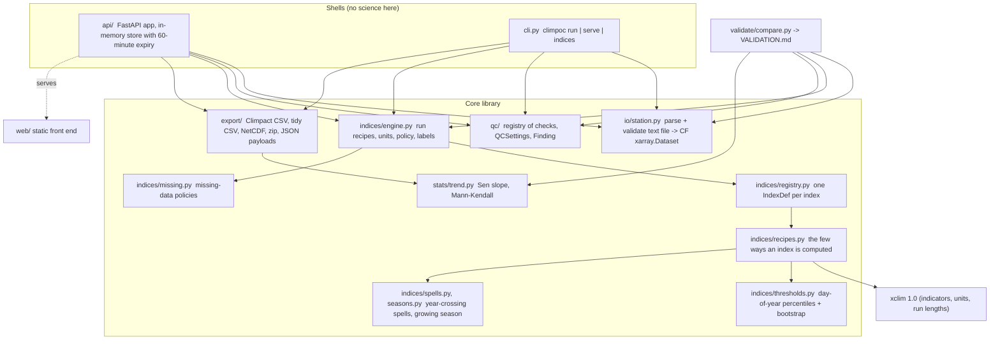

# Architecture

One Python package, `climpoc`, with a scientific core and two thin shells (web API and command
line) that call the same functions. The core never imports the web framework.

## Modules



| Path | Responsibility | Depends on |
|---|---|---|
| `io/station.py` | Read the six-column station format; line-numbered errors; output a gap-free daily `xarray.Dataset` with CF attributes that xclim accepts without warnings | pandas, xarray |
| `qc/base.py`, `qc/checks/*.py`, `qc/__init__.py` | One module per check, a common `Finding`, a registry, thresholds in `QCSettings`, `run_qc()` | pandas |
| `indices/registry.py` | Declarative list of indices: identifier, names, units, inputs, frequencies, recipe and its parameters | recipes |
| `indices/recipes.py` | Six recipes: `XclimIndicator`, `PercentileDays`, `SpellDuration`, `PrecipAboveQuantile`, `LongestSpell`, `GrowingSeason` | xclim, thresholds, spells, seasons |
| `indices/thresholds.py` | climdex-compatible day-of-year percentiles and the Zhang et al. (2005) bootstrap, in numpy | numpy |
| `indices/spells.py` | Longest spell credited to the year in which it ends | numpy, pandas |
| `indices/seasons.py` | Growing season length with start and end dates, from the ETCCDI definition | numpy, pandas |
| `indices/settings.py` | `ComputeSettings` (base period, hemisphere, percentile method) and `UserParameters` (the user-defined indices) | |
| `indices/missing.py` | `ClimdexPolicy` (default), `AnyMissingPolicy`, `FractionPolicy`, `make_policy()` | xarray |
| `indices/engine.py` | `compute_indices()`: run each recipe, convert units, apply the policy, label periods, collect skipped indices with reasons | all of the above |
| `stats/trend.py` | Sen's slope with 95 % bounds, Mann-Kendall p-value | numpy, scipy |
| `export/` | Climpact-style CSV (and a reader for it), tidy CSV, NetCDF, trend and QC tables, zip bundle with README, JSON payloads | core only |
| `api/` | Routes, structured errors, in-memory store, static files with cache headers and compression; `config.py` (limits and cross-origin access from environment variables), `ratelimit.py` (optional request limit) | FastAPI, core |
| `cli.py` | `climpoc run`, `climpoc serve`, `climpoc indices` | core, uvicorn |
| `validate/` | Comparison with the R tool's outputs; writes `VALIDATION.md`, `validate/validation.json` and the status file behind the API's `validated` flag | core |

## Data flow

1. **Parse.** `parse_station_text()` checks every line (column count, numbers, real dates), then
   the chronology (repeated dates, order, absent days). Problems are collected, not raised one
   at a time, so a user sees up to 50 of them with line numbers in one response. The result is a
   `ParsedStation`: the daily dataset, the rows as written (for QC) and non-fatal notes.
2. **Quality control.** `run_qc(records, settings)` runs every registered check and returns a
   `QCReport`. It is a pure function of rows and thresholds, so re-running with other
   thresholds is one call (`POST /api/datasets/{id}/qc`).
3. **Compute.** `compute_indices(dataset, ids, frequency, settings, policy)`:
   * the registry entry names a recipe; the recipe returns one raw value per period;
   * the engine converts units (kelvin to degC, and so on), failing loudly on anything unexpected;
   * the engine asks the missing-data policy which periods are missing, given the daily
     presence of the index's input variables (days outside the record count as missing);
   * periods are labelled `YYYY` or `YYYY-MM`; an index that cannot be computed is returned in
     `skipped` with a plain-language reason instead of failing the request.
   xclim's own missing-value checks are switched off (`check_missing="skip"`) so that exactly
   one, named, configurable policy applies to every index.
4. **Summarise and export.** Trends and summary statistics are computed from the results when a
   payload or file is built. All exports are produced in memory; only the command line writes
   files.

## Design decisions

* **xclim does the science wherever it can.** 32 of the 48 indices are a single xclim indicator
  call with parameters, and WSDI and CSDI count runs with xclim's run-length helpers. Custom
  code exists only where xclim's behaviour differs from Climpact's in a way that settings cannot
  remove: the percentile thresholds and bootstrap (29 February, window wrap, speed), spells
  credited to the year they end in, the growing season (xclim treats days at exactly 5 degC and
  seasons that start late differently), and R95p as an amount. Each recipe's docstring says why,
  and `VALIDATION.md` measures the difference in each case. The xclim-native percentile path is
  kept as a labelled option (`percentile_method="xclim"`).
* **User-defined indices are generated, not listed.** `definitions_for(parameters)` adds the
  indices whose identifier carries a user parameter (`wsdi5`, `hddheat15`, `rx7day`, `r25mm`) to
  the fixed ones, as the R tool names them.
* **Station first, gridded later.** Recipes operate on `xarray` objects with a `time` dimension.
  The xclim calls are already dimension-agnostic. The numpy percentile code and the spell code
  work on one series; for grids they would be wrapped with `xarray.apply_ufunc` over the spatial
  dimensions (dask-parallel), and the API would run them as background jobs.
* **No hidden state.** Settings (`ComputeSettings`), QC thresholds (`QCSettings`) and the policy
  are immutable values passed in and written into every export.
* **Privacy.** The API keeps uploads in a dictionary in memory, evicts them after 60 minutes
  (lazily on each access and by a sweep every minute), offers `DELETE`, and never writes user
  data to disk; Starlette's default of spooling large uploads to a temporary file is disabled.
  The only disk write is numba's compiled-code cache.
* **Safe to expose, by configuration.** Upload size, number of datasets and their lifetime are
  environment settings validated at start-up; cross-origin access and a per-client request limit
  are off unless configured (`api/config.py`, [api-contract.md](api-contract.md)).

## How to add an index

Most indices are one registry entry. Worked example: **TXge40**, days with a maximum of at
least 40 degC, annual and monthly.

In `src/climpoc/indices/registry.py`, add to `_DEFINITIONS`:

```python
(
    IndexDef(
        "txge40",
        "TXge40",
        "Extremely hot days",
        "Number of days when daily maximum temperature is at least 40 degC",
        T,
        "days",
        TX,
        BOTH,
        _count("tx_days_above", "tasmax", "tasmax", "40 degC", ">="),
    ),
)
```

That is all: `inputs=TX` makes the missing-data mask follow tmax, `BOTH` offers annual and
monthly, and the entry appears in `GET /api/indices`, in the UI, in the command line and in every
export. `_count(...)` is shorthand for
`XclimIndicator("atmos.tx_days_above", {"tasmax": "tasmax"}, {"thresh": "40 degC", "condition": ">="})`.

Then add a test with a hand-countable input (see `test_threshold_counts_use_strict_and_inclusive_comparisons`
in `tests/test_indices.py`), and, if the R tool produces the index, a reference output so that
`validate/compare.py` picks it up; until then the API reports it as `validated: false`.

An index that needs logic xclim does not have gets a new recipe: a frozen dataclass in
`recipes.py` with a `compute(context, freq) -> Computed` method. `Computed` carries the values
and, optionally, extra columns (dates), the daily presence series for the missing-data mask, and
a non-calendar period (`"YS-JUL"`). Units, masking and labelling stay in the engine.

## How to add a QC check

One module with one decorated function. Worked example: **precipitation recorded on too few
days**, a year with fewer than 10 rain days, which often means that zeros were entered for
missing observations.

Create `src/climpoc/qc/checks/dry_years.py`:

```python
"""Years with implausibly few rain days."""

from __future__ import annotations

import pandas as pd

from climpoc.qc.base import Finding, QCSettings, register


@register("dry_years", "Very few rain days", "warning", lambda settings: "Years with fewer than 10 days of rain")
def dry_years(records: pd.DataFrame, settings: QCSettings) -> list[Finding]:
    rain_days = (records["pr"] > 0).groupby(records["date"].dt.year).sum()
    return [
        Finding(pd.Timestamp(year=int(year), month=1, day=1), "pr", None, f"{year}: {count} rain days")
        for year, count in rain_days.items()
        if count < 10
    ]
```

Import it in `src/climpoc/qc/checks/__init__.py` so that it registers. It now runs in `run_qc()`,
appears in the API's `qc.checks`, in the UI and in the QC export. To make the limit adjustable,
add a field to `QCSettings` (for example `min_rain_days: int = 10`) and read
`settings.min_rain_days`; it is then accepted by `POST /api/datasets/{id}/qc` without further
code. Built-in checks appear in the order of `REPORT_ORDER` in `qc/__init__.py`; new checks
follow. `tests/test_qc.py::test_a_new_check_is_one_registered_function` exercises this path.

## How to add a missing-data policy

A frozen dataclass with `id`, `period_is_missing(present, freq)` and `describe()`, added to
`POLICIES` in `indices/missing.py`. `FractionPolicy` is a 10-line example. It is then selectable
by `--missing-policy` on the command line and by `missing_policy.id` in the compute request.
